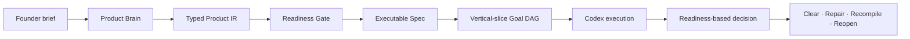

# Build Beyond Fable

Founder Product Compiler turns founder intent into a coherent, validated build
contract that Codex can execute.

Fable is the reference product and quality bar that motivated this project.
Founder Product Compiler is designed to help teams build beyond that bar by
preserving product intent from the first brief through implementation review.
This is a product-development system, not an unverified promise that any tool
automatically produces a better product.

[English](README.md) · [한국어](docs/i18n/README.ko.md) ·
[日本語](docs/i18n/README.ja.md) · [简体中文](docs/i18n/README.zh-CN.md) ·
[Español](docs/i18n/README.es.md)

> Define the product once. Give Codex a contract it can execute. Judge the
> result against the product you meant to build.

## The Product Compiler in One View

```text
Founder brief
    ↓
Product IR + readiness gate
    ↓
Executable specification
    ↓
Vertical-slice Goal DAG
    ↓
Codex execution
    ↓
    Readiness-based product decision
```

## What You Gain

### Preserve the product thesis

Codex should not optimize one ticket at a time while losing the product you
intended to build. Founder Product Compiler keeps the target user, problem,
promise, magic moment, and non-goals visible throughout execution.

### Catch gaps before coding

Missing journeys, contradictory decisions, weak acceptance criteria, and an
undefined first-use experience are surfaced before implementation begins.

### Turn intent into executable work

The compiler produces a typed Product IR, a readiness report, an executable
specification, and a deterministic Goal DAG that a coding agent can follow and
review.

### Reduce founder micromanagement

Resolve the decisions that materially change the product up front. Then let
Codex work inside explicit product, evidence, and autonomy boundaries.

### Make product decisions explicit

The v0 Product Judge helper turns readiness findings into an explicit decision:
clear, repair locally, recompile, or reopen the product decision. It is a
readiness-based decision model for the compiled brief, not a claim that v0
executes Code, Journey, and Thesis oracles against a finished codebase.

## Before / After

Before:

```text
“Build onboarding, add billing, improve the dashboard,
and make it feel premium.”
```

After:

```text
Product thesis
├── target user
├── painful alternative
├── product promise
├── magic moment
└── non-goals

Executable build contract
├── readiness verdict
├── user journeys
├── vertical slices
├── global acceptance
├── autonomy budget
└── deterministic Goal DAG
```

## How It Works

Founder Product Compiler adds a product-level reasoning layer between founder
intent and code generation.



### Product Brain

Organizes the user, problem, promise, magic moment, constraints, and
non-goals into one product logic.

### Typed Product IR

Converts natural-language intent into a structured, schema-validated model.

### Readiness Gate

Prevents premature implementation when a critical product decision is missing,
contradictory, or not linked to a verifiable acceptance condition.

### Vertical-slice Goal DAG

Plans work around complete user value instead of producing disconnected layers
of frontend, backend, and infrastructure tasks.

### Product Judge decision model

The library exposes a small readiness-based decision helper. It returns
`CLEAR`, `REPAIR_LOCAL`, `RECOMPILE`, or `REOPEN_PRODUCT` from the compiled
Product IR and readiness report. The v0 CLI does not emit a
`product-judge.json` file and does not yet execute Code, Journey, or Thesis
oracles against a finished implementation. Evidence adapters and richer
product-level judgment are future roadmap work.

## Why It Is Different

| Approach | What it provides | What Founder Product Compiler adds |
| --- | --- | --- |
| Prompt collection | Reusable instructions | A typed product artifact and readiness contract |
| Task planner | A list of implementation tasks | Global acceptance and vertical-slice sequencing |
| Autonomous coding agent | Direct code changes | A reviewable boundary before code execution |
| Founder Product Compiler | Product intent to build contract | Product-level readiness decisions before code execution |

It is not another coding agent. It tells coding agents what the whole product
must become, and how to detect drift before the work is considered complete.

## Start in 60 Seconds

### 1. Install the Codex plugin

In Codex, add the repository marketplace at the verified immutable release
commit:

```text
codex plugin marketplace add plugtheliam/founder-product-compiler --ref 2a869c0a83f7547eb4e964b9b75543be2ec5d93a
```

Open `/plugins`, install `founder-product-compiler`, and start a new session.
The full 40-character SHA is the verified installation target. The `v0.1.0`
tag is a convenience tag for browsing; do not substitute a moving branch or
tag in copied installation commands.

### 2. Give Codex a product brief

Attach or paste a JSON/YAML brief, then invoke:

```text
$founder-product-compiler
```

Or use this instruction:

```text
Use Founder Product Compiler to turn the attached product brief into
a validated executable specification.

Ask me only about decisions that materially affect the product.
Do not begin implementation until the readiness gate passes.
```

### 3. Review the generated contract

The Codex skill writes to `.product/founder-product-compiler/<slug>` by
default. A `READY` compilation produces:

```text
.product/founder-product-compiler/<slug>/
├── product-ir.json
├── readiness.json
├── executable-spec.json
├── goal-dag.json
├── diagnostics.json
└── compilation-receipt.json
```

These are the six JSON artifacts emitted by the current v0 compiler. A
`NOT_READY` run emits the partial Product IR, readiness, diagnostics, and
receipt; it does not emit the executable specification or Goal DAG.

The standalone compiler also accepts JSON or YAML. Requires Node.js 20 or
newer:

```bash
npm ci
npm run build
node dist/src/cli.js --input examples/canonical-input.json --out .product/out
npm run validate:schemas -- .product/out
```

`READY` exits with `0`, `NOT_READY` with `2`, and malformed or unsafe input
with `1`. Existing artifacts require explicit `--force`; symlink targets and
symlink output directories are refused.

## Trust and Safety

- Local-only runtime: no product account, API key, network, or authentication.
- No MCP server. No telemetry, analytics, deployment, or OpenAI endorsement.
- The compiler does not mutate product code or publish generated artifacts.
- Source bindings and deterministic artifacts make decisions reviewable.
- The readiness gate reports missing information instead of inventing product
  promises, journeys, or goals.

At runtime, there is no account, no network access, and no telemetry.
Runtime requires no product account, API key, network, or auth.

Codex host marketplace installation may still request host authorization because
the marketplace metadata declares `ON_INSTALL`. See [SECURITY.md](SECURITY.md),
[PRIVACY.md](PRIVACY.md), and [THIRD_PARTY_NOTICES.md](THIRD_PARTY_NOTICES.md).

## Compatibility and Limitations

The public release is English-first, Apache-2.0 licensed, skills-only, and
tested against the repository-native compiler boundary. It does not include a
multi-agent runtime, deployment automation, browser automation, billing UI,
runtime autonomy-budget enforcement, or a Fable replacement benchmark.

Use the standalone CLI when you need deterministic local compilation without a
Codex session. Use the plugin when you want Codex to ask for missing decisions
and continue from the generated contract.

## Roadmap

- Keep the Korean, Japanese, Simplified Chinese, and Spanish documentation in
  parity with this English README.
- More founder-facing examples, readiness fixtures, and product-judge decision
  tests.
- Runtime enforcement for pause, rollback, cancellation, and autonomy budgets.
- Code, Journey, and Thesis evidence adapters for post-implementation judging.
- Additional evidence-backed comparisons against reference products.
- Public plugin directory submission after listing and policy review.

## Development and Release Checks

```bash
npm ci
npm run typecheck
npm test
npm run build
npm run build:plugin
npm run validate:public
npm run check:plugin
```

Read [the architecture](docs/ARCHITECTURE.md),
[diagnostic contract](docs/DIAGNOSTICS.md),
[examples](docs/EXAMPLES.md), and the
[public release plan](docs/PUBLIC_RELEASE_PLAN.md) for implementation detail.
See the [showcase](docs/SHOWCASE.md), [roadmap](docs/ROADMAP.md), and
[translation guide](docs/TRANSLATION_GUIDE.md) for public project context.
The [social-preview asset](docs/assets/social-preview.svg) is available for
launch posts and repository metadata.

## Contributing

Start with [CONTRIBUTING.md](CONTRIBUTING.md). Changes to compiler behavior
should include tests, preserve deterministic output, and update generated
plugin artifacts when relevant. Documentation translations should follow the
same section order as this canonical English README.

Found a product gap, confusing output, or a useful founder workflow? [Open an
issue](https://github.com/plugtheliam/founder-product-compiler/issues/new/choose),
propose an example, or [start a discussion](https://github.com/plugtheliam/founder-product-compiler/discussions/categories/q-a).
If Discussions are unavailable for the publisher, the issue link remains the
working fallback. If the idea resonates, star the repository and share the
project with a founder or product team building with Codex.

## License

Apache-2.0. See [LICENSE](LICENSE).
