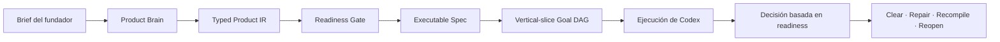

# Construye más allá de Fable

Founder Product Compiler convierte la intención del fundador en un contrato de
construcción coherente y validado que Codex puede ejecutar.

Fable es el producto de referencia y el estándar de calidad que motivó este
proyecto. Founder Product Compiler está diseñado para conservar la intención del
producto desde el primer brief hasta la revisión de implementación, ayudando a
los equipos a superar ese estándar. No es una promesa no verificada de que una
herramienta produzca automáticamente un producto mejor.

[English](../../README.md) · [한국어](README.ko.md) ·
[日本語](README.ja.md) · [简体中文](README.zh-CN.md) ·
[Español](README.es.md)

> Define el producto una vez. Entrega a Codex un contrato que pueda ejecutar.
> Evalúa el resultado frente al producto que realmente querías construir.

## El compilador de producto en una vista

```text
Brief del fundador
    ↓
Product IR + Readiness Gate
    ↓
Especificación ejecutable
    ↓
Vertical-slice Goal DAG
    ↓
Ejecución de Codex
    ↓
    Decisión de producto basada en readiness
```

## Qué obtienes

### Conserva la tesis del producto

Codex no debería optimizar un ticket cada vez mientras pierde de vista el
producto que querías construir. Founder Product Compiler mantiene visibles el
usuario objetivo, el problema, la promesa, el Magic Moment y los no objetivos
durante toda la ejecución.

### Detecta las brechas antes de programar

Los journeys incompletos, las decisiones contradictorias, los acceptance
criteria débiles y una primera experiencia sin definir aparecen antes de que
comience la implementación.

### Convierte la intención en trabajo ejecutable

El compilador produce un typed Product IR, un readiness report, una executable
specification y un deterministic Goal DAG que un coding agent puede seguir y
revisar.

### Reduce la microgestión del fundador

Resuelve primero las decisiones que cambian materialmente el producto. Después,
deja que Codex trabaje dentro de límites explícitos de producto, evidencia y
autonomy.

### Hace explícitas las decisiones de producto

El helper Product Judge de v0 convierte los readiness findings en una decisión
explícita: `CLEAR`, `REPAIR_LOCAL`, `RECOMPILE` o `REOPEN_PRODUCT`. Es un modelo de
decisión basado en readiness para el brief compilado; no significa que v0 ejecute
oracles de Code, Journey y Thesis sobre un código terminado.

## Before / After

Before:

```text
“Construye el onboarding, añade facturación, mejora el dashboard
y haz que se sienta premium.”
```

After:

```text
Tesis del producto
├── usuario objetivo
├── alternativa dolorosa
├── promesa del producto
├── Magic Moment
└── no objetivos

Contrato de construcción ejecutable
├── readiness verdict
├── journeys de usuario
├── vertical slices
├── global acceptance
├── autonomy budget
└── deterministic Goal DAG
```

## Cómo es posible

Founder Product Compiler añade una capa de razonamiento a nivel de producto
entre la intención del fundador y la generación de código.



### Product Brain

Organiza el usuario, el problema, la promesa, el Magic Moment, las restricciones
y los no objetivos en una única lógica de producto.

### Typed Product IR

Convierte la intención en lenguaje natural en un modelo estructurado y
schema-validated.

### Readiness Gate

Evita comenzar la implementación prematuramente cuando falta una decisión de
producto crítica, existe una contradicción o no hay una conexión con una
acceptance condition verificable.

### Vertical-slice Goal DAG

Planifica el trabajo alrededor de valor completo para el usuario, en vez de
producir capas desconectadas de frontend, backend e infraestructura.

### Modelo de decisión Product Judge

La biblioteca expone un pequeño helper de decisión basado en readiness. A partir
del Product IR compilado y del readiness report, devuelve `CLEAR`, `REPAIR_LOCAL`,
`RECOMPILE` o `REOPEN_PRODUCT`. La CLI de v0 no genera `product-judge.json` ni
ejecuta todavía oracles de Code, Journey o Thesis sobre una implementación
terminada. Los adaptadores de evidencia y un juicio de producto más rico quedan
para el roadmap.

## Qué lo hace diferente

| Enfoque | Qué proporciona | Qué añade Founder Product Compiler |
| --- | --- | --- |
| Prompt collection | Instrucciones reutilizables | Un typed product artifact y un readiness contract |
| Task planner | Una lista de tareas de implementación | Global acceptance y vertical-slice sequencing |
| Autonomous coding agent | Cambios directos en el código | Un límite revisable antes de ejecutar código |
| Founder Product Compiler | De la intención al contrato de construcción | Decisiones de readiness a nivel de producto antes del código |

No es otro coding agent. Indica a los coding agents en qué debe convertirse el
producto completo y cómo detectar drift antes de considerar terminado el trabajo.

## Empieza en 60 segundos

### 1. Instala el plugin de Codex

Añade el repository marketplace a Codex desde el commit de release inmutable y
verificado:

```text
codex plugin marketplace add plugtheliam/founder-product-compiler --ref 2a869c0a83f7547eb4e964b9b75543be2ec5d93a
```

Abre `/plugins`, instala `founder-product-compiler` e inicia una sesión nueva.
El SHA completo de 40 caracteres es el objetivo de instalación verificado.
La etiqueta `v0.1.0` es un convenience tag para consultar el contenido; no
sustituyas el commit por una rama o etiqueta móvil en los comandos que copies.

### 2. Entrega a Codex un brief de producto

Adjunta o pega un brief JSON/YAML y ejecuta:

```text
$founder-product-compiler
```

También puedes usar esta instrucción:

```text
Use Founder Product Compiler to turn the attached product brief into
a validated executable specification.

Ask me only about decisions that materially affect the product.
Do not begin implementation until the readiness gate passes.
```

### 3. Revisa el contrato generado

Codex skill escribe por defecto en `.product/founder-product-compiler/<slug>`.
Una compilación `READY` produce:

```text
.product/founder-product-compiler/<slug>/
├── product-ir.json
├── readiness.json
├── executable-spec.json
├── goal-dag.json
├── diagnostics.json
└── compilation-receipt.json
```

Estos son los seis artifact JSON que emite el compiler v0 actual. Una ejecución
`NOT_READY` produce el Product IR parcial, readiness, diagnostics y receipt; no
produce la executable specification ni el Goal DAG.

El standalone compiler también acepta JSON o YAML. Requiere Node.js 20 o posterior:

```bash
npm ci
npm run build
node dist/src/cli.js --input examples/canonical-input.json --out .product/out
npm run validate:schemas -- .product/out
```

`READY` termina con `0`, `NOT_READY` con `2` y una entrada malformada o insegura
con `1`. Los artifact existentes requieren `--force` explícito; los destinos
symlink y los output directory symlink son rechazados.

## Confianza y seguridad

- Runtime local únicamente: no necesita cuenta de producto, API key, red ni
  autenticación.
- No hay servidor MCP, telemetría, analítica, despliegue ni OpenAI endorsement.
- El compiler no modifica el código del producto ni publica los artifact generados.
- Los source bindings y deterministic artifacts permiten revisar las decisiones.
- El readiness gate informa de la información que falta en lugar de inventar
  promesas, journeys u objetivos del producto.

En runtime no hay cuenta, acceso a la red ni telemetría. El runtime no requiere
cuenta de producto, API key, network ni auth.

La instalación desde el Codex host marketplace puede solicitar host authorization
porque el marketplace metadata declara `ON_INSTALL`. Consulta [SECURITY.md](../../SECURITY.md),
[PRIVACY.md](../../PRIVACY.md) y
[THIRD_PARTY_NOTICES.md](../../THIRD_PARTY_NOTICES.md).

## Compatibilidad y limitaciones

La release pública es English-first, Apache-2.0, skills-only y está probada contra
el límite del compiler repository-native. No incluye multi-agent runtime,
deployment automation, browser automation, billing UI, runtime autonomy-budget
enforcement ni Fable replacement benchmark.

Usa el standalone CLI cuando necesites compilación local determinista sin una
sesión de Codex. Usa el plugin cuando quieras que Codex pregunte por decisiones
faltantes y continúe desde el contrato generado.

## Hoja de ruta

- Mantener la documentación en coreano, japonés, chino simplificado y español
  alineada con el README en inglés
- Más ejemplos para fundadores, readiness fixtures y product-judge decision tests
- Runtime enforcement para pause, rollback, cancellation y autonomy budgets
- Adaptadores de evidencia Code, Journey y Thesis para el juicio posterior a la implementación
- Comparaciones adicionales, basadas en evidencia, con productos de referencia
- Envío al public plugin directory después de revisar listing y policy

## Comprobaciones de desarrollo y publicación

```bash
npm ci
npm run typecheck
npm test
npm run build
npm run build:plugin
npm run validate:public
npm run check:plugin
```

Consulta la [arquitectura](../../docs/ARCHITECTURE.md), el [diagnostic contract](../../docs/DIAGNOSTICS.md),
los [ejemplos](../../docs/EXAMPLES.md) y el [public release plan](../../docs/PUBLIC_RELEASE_PLAN.md)
para conocer los detalles de implementación.
Para el contexto público, consulta el [showcase](../../docs/SHOWCASE.md), el
[roadmap](../../docs/ROADMAP.md) y la [translation guide](../../docs/TRANSLATION_GUIDE.md).
El [social-preview asset](../../docs/assets/social-preview.svg) está disponible para
publicaciones de lanzamiento y metadata del repositorio.

## Contribuir

Empieza por [CONTRIBUTING.md](../../CONTRIBUTING.md). Los cambios de comportamiento
del compiler deben incluir pruebas, conservar el deterministic output y actualizar
los plugin artifacts generados cuando corresponda. Las traducciones de documentación
deben seguir el mismo section order que el canonical English README.

Si encuentras una brecha de producto, una salida confusa o un founder workflow útil,
[abre un issue](https://github.com/plugtheliam/founder-product-compiler/issues/new/choose),
propón un ejemplo o [inicia una discussion](https://github.com/plugtheliam/founder-product-compiler/discussions/categories/q-a).
Si Discussions no está disponible, el enlace de issues sigue siendo el fallback
funcional. Si el proyecto te resulta útil, dale star al repository y compártelo con
un fundador o equipo de producto que construya con Codex.

## Licencia

Apache-2.0. Consulta [LICENSE](../../LICENSE).
