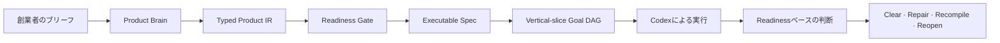

# Fableを超えて構築する

Founder Product Compilerは、創業者のプロダクト意図をCodexが実行できる
一貫した検証済みのビルド契約へ変換します。

Fableは、このプロジェクトを始めるきっかけとなったリファレンス製品であり、
品質の基準です。Founder Product Compilerは、最初のブリーフから実装レビュー
までプロダクトの意図を保ち、その基準を超えるプロダクトをチームが構築できる
よう設計されています。どのツールでも自動的により良いプロダクトを作れると
保証する、検証されていない約束ではありません。

[English](../../README.md) · [한국어](README.ko.md) ·
[日本語](README.ja.md) · [简体中文](README.zh-CN.md) ·
[Español](README.es.md)

> プロダクトを一度定義する。Codexに実行できる契約を渡す。作りたかった
> プロダクトを基準に、結果を評価する。

## プロダクトコンパイラの全体像

```text
創業者のブリーフ
    ↓
Product IR + Readiness Gate
    ↓
実行可能な仕様
    ↓
Vertical-slice Goal DAG
    ↓
Codexによる実行
    ↓
    readinessベースのプロダクト判断
```

## 得られるもの

### プロダクトの論旨を保つ

Codexがチケットを一つずつ最適化するうちに、最初に意図したプロダクトを
見失うことを防ぎます。対象ユーザー、課題、約束、Magic Moment、非目標を
実行の全過程で確認できます。

### コーディング前にギャップを見つける

欠けたユーザージャーニー、矛盾する意思決定、弱いacceptance criteria、
定義されていない初回体験を実装前に明らかにします。

### 意図を実行可能な作業に変える

typed Product IR、readiness report、executable specification、そして
コーディングエージェントが追従できる deterministic Goal DAG を生成します。

### 創業者のマイクロマネジメントを減らす

プロダクトを大きく変える意思決定だけを先に解決します。その後は、明示した
プロダクト・証拠・autonomyの境界内でCodexに作業させます。

### プロダクトの判断を明示する

v0のProduct Judge helperはreadinessのfindingを明示的な判断に変換します。
`CLEAR`、`REPAIR_LOCAL`、`RECOMPILE`、`REOPEN_PRODUCT`のいずれかを返します。
これはコンパイル済みブリーフのためのreadinessベースの判断モデルです。v0が
完成したコードベースにCode、Journey、Thesis oracleを実行するという意味では
ありません。

## Before / After

Before:

```text
「オンボーディングを作り、決済を追加し、ダッシュボードを改善して、
プレミアムに感じられるようにして。」
```

After:

```text
プロダクトの論旨
├── 対象ユーザー
├── 苦痛を伴う代替手段
├── プロダクトの約束
├── Magic Moment
└── 非目標

実行可能なビルド契約
├── readiness verdict
├── ユーザージャーニー
├── vertical slices
├── global acceptance
├── autonomy budget
└── deterministic Goal DAG
```

## どのように可能にするか

Founder Product Compilerは、創業者の意図とコード生成の間にプロダクトレベルの
推論レイヤーを追加します。



### Product Brain

ユーザー、課題、約束、Magic Moment、制約、非目標を一つのプロダクトロジック
に整理します。

### Typed Product IR

自然言語の意図を、構造化されたschema-validatedモデルへ変換します。

### Readiness Gate

重要なプロダクトの決定が欠けている、矛盾している、検証可能なacceptance
conditionに結び付いていない状態で、性急に実装を始めることを防ぎます。

### Vertical-slice Goal DAG

フロントエンド、バックエンド、インフラを分断されたレイヤーとして作るのでは
なく、完全なユーザー価値を中心に作業を計画します。

### Product Judgeの判断モデル

ライブラリは小さなreadinessベースの判断helperを公開します。コンパイル済みの
Product IRとreadiness reportから`CLEAR`、`REPAIR_LOCAL`、`RECOMPILE`、
`REOPEN_PRODUCT`を返します。v0 CLIは`product-judge.json`を生成せず、完成した
実装にCode、Journey、Thesis oracleをまだ実行しません。証拠adapterと、より
豊かなプロダクトレベルの判断は今後のロードマップです。

## 何が違うのか

| アプローチ | 提供するもの | Founder Product Compilerが加えるもの |
| --- | --- | --- |
| Prompt collection | 再利用可能な指示 | typed product artifactとreadiness contract |
| Task planner | 実装タスクの一覧 | global acceptanceとvertical-slice sequencing |
| Autonomous coding agent | コードを直接変更 | コード実行前にレビューできる境界 |
| Founder Product Compiler | プロダクト意図からビルド契約まで | コード実行前のプロダクトレベルreadiness判断 |

これは別のcoding agentではありません。コーディングエージェントがプロダクト
全体をどう形にすべきか、そして完了と判断する前にdriftをどう検出するかを示す
プロダクトコンパイラです。

## 60秒で始める

### 1. Codexプラグインをインストールする

検証済みの不変なリリースコミットからrepository marketplaceをCodexに追加します。

```text
codex plugin marketplace add plugtheliam/founder-product-compiler --ref 2a869c0a83f7547eb4e964b9b75543be2ec5d93a
```

`/plugins`を開き、`founder-product-compiler`をインストールして新しい
セッションを開始してください。40文字の完全なSHAが検証済みのインストール
対象です。`v0.1.0`タグは閲覧用のconvenience tagです。コピーするインストール
コマンドで、moving branchやtagに置き換えないでください。

### 2. Codexにプロダクトブリーフを渡す

JSON/YAMLのブリーフを添付または貼り付け、次を呼び出します。

```text
$founder-product-compiler
```

または、次の指示を使います。

```text
Use Founder Product Compiler to turn the attached product brief into
a validated executable specification.

Ask me only about decisions that materially affect the product.
Do not begin implementation until the readiness gate passes.
```

### 3. 生成された契約をレビューする

Codex skillはデフォルトで`.product/founder-product-compiler/<slug>`に
書き込みます。`READY` compilationでは次が生成されます。

```text
.product/founder-product-compiler/<slug>/
├── product-ir.json
├── readiness.json
├── executable-spec.json
├── goal-dag.json
├── diagnostics.json
└── compilation-receipt.json
```

現在のv0 compilerが生成するのは上記6つのJSON artifactです。`NOT_READY`の
実行ではpartial Product IR、readiness、diagnostics、receiptだけが生成され、
executable specificationとGoal DAGは生成されません。

standalone compilerはJSONとYAMLの両方に対応します。Node.js 20以上が必要です。

```bash
npm ci
npm run build
node dist/src/cli.js --input examples/canonical-input.json --out .product/out
npm run validate:schemas -- .product/out
```

`READY`は`0`、`NOT_READY`は`2`、不正または安全でない入力は`1`で終了します。
既存artifactの上書きには明示的な`--force`が必要で、symlinkの対象とsymlinkの
output directoryは拒否されます。

## 信頼と安全性

- Local-only runtimeです。プロダクトアカウント、API key、ネットワーク、認証は
  不要です。
- MCPサーバーはありません。テレメトリ、分析、デプロイ、OpenAI endorsementも
  ありません。
- compilerはプロダクトコードを変更せず、生成したartifactも公開しません。
- source bindingとdeterministic artifactによって意思決定をレビューできます。
- readiness gateはプロダクトの約束、ジャーニー、目標を作り出すのではなく、
  不足情報を報告します。

実行時にアカウント、ネットワーク、テレメトリはありません。runtimeに
プロダクトアカウント、API key、network、authは必要ありません。

Codex host marketplaceのインストールでは、marketplace metadataが
`ON_INSTALL`を宣言しているため、host authorizationを求められる場合が
あります。[SECURITY.md](../../SECURITY.md)、[PRIVACY.md](../../PRIVACY.md)、
[THIRD_PARTY_NOTICES.md](../../THIRD_PARTY_NOTICES.md)を確認してください。

## 対応状況と制限

公開リリースはEnglish-first、Apache-2.0、skills-onlyで、repository-native
compilerの境界に対してテストされています。multi-agent runtime、deployment
automation、browser automation、billing UI、runtime autonomy-budget
enforcement、Fable replacement benchmarkは含まれません。

Codexセッションなしでdeterministicなローカルコンパイルを行う場合はstandalone
CLIを使います。Codexに不足した意思決定を質問させ、生成された契約から続ける
場合はpluginを使います。

## ロードマップ

- 韓国語、日本語、Simplified Chinese、Spanishの文書をEnglish READMEと同期
- 創業者向けの例、readiness fixture、product-judge decision testを拡充
- pause、rollback、cancellation、autonomy budgetのruntime enforcement
- 実装後の判断に向けたCode、Journey、Thesis evidence adapter
- リファレンス製品とのevidence-backed comparisonを追加
- listingとpolicy review後のpublic plugin directory提出

## 開発とリリースのチェック

```bash
npm ci
npm run typecheck
npm test
npm run build
npm run build:plugin
npm run validate:public
npm run check:plugin
```

[architecture](../../docs/ARCHITECTURE.md)、[diagnostic contract](../../docs/DIAGNOSTICS.md)、
[examples](../../docs/EXAMPLES.md)、[public release plan](../../docs/PUBLIC_RELEASE_PLAN.md)
で実装の詳細を確認できます。
公開例は[showcase](../../docs/SHOWCASE.md)、[roadmap](../../docs/ROADMAP.md)、
[translation guide](../../docs/TRANSLATION_GUIDE.md)を参照してください。
リリース投稿やrepository metadataには
[social-preview asset](../../docs/assets/social-preview.svg)を利用できます。

## コントリビューション

まず[CONTRIBUTING.md](../../CONTRIBUTING.md)を読んでください。compilerの動作を
変更する場合はテストを追加し、deterministic outputを保ち、必要に応じて生成済み
plugin artifactを更新してください。ドキュメント翻訳はcanonical English READMEと
同じsection orderに従います。

プロダクトのギャップ、分かりにくい出力、役立つfounder workflowを見つけたら、
[issueを開く](https://github.com/plugtheliam/founder-product-compiler/issues/new/choose)、
例を提案する、[discussionを始める](https://github.com/plugtheliam/founder-product-compiler/discussions/categories/q-a)
などの方法で知らせてください。Discussionが利用できない場合もissueリンクを
利用できます。役立つと思ったらrepositoryにstarを付け、Codexで構築する創業者や
プロダクトチームに共有してください。

## ライセンス

Apache-2.0。[LICENSE](../../LICENSE)を参照してください。
