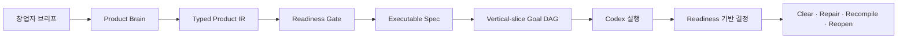

# Fable을 넘어 빌드하기

Founder Product Compiler는 창업자의 제품 의도를 Codex가 실행할 수 있는
일관되고 검증된 빌드 계약으로 바꿉니다.

Fable은 이 프로젝트를 시작하게 만든 기준 제품이자 품질 기준입니다.
Founder Product Compiler는 첫 브리프부터 구현 검토까지 제품 의도를 보존해
팀이 그 기준을 넘어서는 제품을 만들 수 있도록 설계되었습니다. 어떤 도구도
자동으로 더 나은 제품을 만든다고 보장하는 검증되지 않은 약속은 아닙니다.

[English](../../README.md) · [한국어](README.ko.md) ·
[日本語](README.ja.md) · [简体中文](README.zh-CN.md) ·
[Español](README.es.md)

> 제품을 한 번 정의하세요. Codex가 실행할 수 있는 계약을 주세요. 만들고자
> 했던 제품을 기준으로 결과를 평가하세요.

## 제품 컴파일러 한눈에 보기

```text
창업자 브리프
    ↓
Product IR + Readiness Gate
    ↓
실행 가능한 사양
    ↓
Vertical-slice Goal DAG
    ↓
Codex 실행
    ↓
    readiness 기반 제품 결정
```

## 창업자가 얻는 효용

### 제품 논리를 보존합니다

Codex가 티켓 하나씩을 최적화하다가 처음 의도한 제품을 잃지 않도록 합니다.
대상 사용자, 문제, 약속, Magic Moment, 비목표를 실행 과정 전체에서 확인할
수 있습니다.

### 코딩 전에 빈틈을 찾습니다

빠진 사용자 여정, 서로 충돌하는 결정, 약한 acceptance criteria, 정의되지
않은 첫 사용 경험을 구현 전에 드러냅니다.

### 의도를 실행 가능한 작업으로 바꿉니다

typed Product IR, readiness report, executable specification, 그리고 코딩
에이전트가 따라갈 수 있는 deterministic Goal DAG를 생성합니다.

### 창업자의 마이크로매니지먼트를 줄입니다

제품을 바꾸는 중요한 결정만 먼저 해결하세요. 그다음 Codex가 명시적인 제품,
근거, autonomy 경계 안에서 작업하게 하세요.

### 제품 결정을 명시적으로 만듭니다

v0 Product Judge helper는 readiness finding을 명시적인 결정으로 바꿉니다.
`CLEAR`, `REPAIR_LOCAL`, `RECOMPILE`, `REOPEN_PRODUCT` 중 하나를 반환합니다.
이는 컴파일된 브리프를 위한 readiness 기반 결정 모델입니다. v0가 완성된
코드베이스에 Code, Journey, Thesis oracle을 실행한다는 의미는 아닙니다.

## Before / After

Before:

```text
“온보딩을 만들고, 결제를 추가하고, 대시보드를 개선하고,
프리미엄처럼 느껴지게 해줘.”
```

After:

```text
제품 논리
├── 대상 사용자
├── 고통스러운 대안
├── 제품 약속
├── Magic Moment
└── 비목표

실행 가능한 빌드 계약
├── readiness verdict
├── 사용자 여정
├── vertical slices
├── global acceptance
├── autonomy budget
└── deterministic Goal DAG
```

## 어떻게 가능한가

Founder Product Compiler는 창업자의 의도와 코드 생성 사이에 제품 수준의
추론 계층을 추가합니다.



### Product Brain

사용자, 문제, 약속, Magic Moment, 제약, 비목표를 하나의 제품 논리로
정리합니다.

### Typed Product IR

자연어 의도를 구조화되고 schema-validated된 모델로 변환합니다.

### Readiness Gate

중요한 제품 결정이 빠졌거나 서로 충돌하거나 검증 가능한 acceptance
condition과 연결되지 않은 상태에서 성급하게 구현하지 못하게 합니다.

### Vertical-slice Goal DAG

프론트엔드, 백엔드, 인프라 작업을 서로 단절된 계층으로 만들지 않고 완전한
사용자 가치 단위로 계획합니다.

### Product Judge 결정 모델

라이브러리는 작은 readiness 기반 결정 helper를 제공합니다. 컴파일된
Product IR과 readiness report를 바탕으로 `CLEAR`, `REPAIR_LOCAL`,
`RECOMPILE`, `REOPEN_PRODUCT`를 반환합니다. v0 CLI는 `product-judge.json`을
생성하지 않으며, 완성된 구현에 Code, Journey, Thesis oracle을 실행하지
않습니다. 근거 adapter와 더 풍부한 제품 수준 판단은 향후 로드맵입니다.

## 무엇이 다른가

| 접근 방식 | 제공하는 것 | Founder Product Compiler가 더하는 것 |
| --- | --- | --- |
| Prompt collection | 재사용 가능한 지시 | typed product artifact와 readiness contract |
| Task planner | 구현 작업 목록 | global acceptance와 vertical-slice sequencing |
| Autonomous coding agent | 직접 코드 변경 | 코드 실행 전 검토 가능한 경계 |
| Founder Product Compiler | 제품 의도에서 빌드 계약까지 | 코드 실행 전 제품 수준 readiness 결정 |

또 하나의 coding agent가 아닙니다. 코딩 에이전트가 전체 제품을 어떤 모습으로
만들어야 하는지, 작업이 끝났다고 판단하기 전에 drift를 어떻게 발견할지를
알려주는 제품 컴파일러입니다.

## 60초 만에 시작하기

### 1. Codex 플러그인 설치

검증된 불변 릴리스 커밋에서 repository marketplace를 Codex에 추가합니다.

```text
codex plugin marketplace add plugtheliam/founder-product-compiler --ref 2a869c0a83f7547eb4e964b9b75543be2ec5d93a
```

`/plugins`를 열어 `founder-product-compiler`를 설치하고 새 세션을
시작하세요. 전체 40자리 SHA가 검증된 설치 대상입니다. `v0.1.0` 태그는
탐색을 위한 convenience tag일 뿐이므로, 복사하는 설치 명령에서 moving
branch나 tag로 대체하지 마세요.

### 2. Codex에 제품 브리프 전달

JSON/YAML 브리프를 첨부하거나 붙여 넣은 뒤 다음을 호출합니다.

```text
$founder-product-compiler
```

또는 다음 지시를 사용하세요.

```text
Use Founder Product Compiler to turn the attached product brief into
a validated executable specification.

Ask me only about decisions that materially affect the product.
Do not begin implementation until the readiness gate passes.
```

### 3. 생성된 계약 검토

Codex skill은 기본적으로 `.product/founder-product-compiler/<slug>`에
기록합니다. `READY` compilation은 다음을 생성합니다.

```text
.product/founder-product-compiler/<slug>/
├── product-ir.json
├── readiness.json
├── executable-spec.json
├── goal-dag.json
├── diagnostics.json
└── compilation-receipt.json
```

현재 v0 compiler가 생성하는 것은 위의 여섯 JSON artifact입니다.
`NOT_READY` 실행에서는 partial Product IR, readiness, diagnostics, receipt만
생성되며 executable specification과 Goal DAG는 생성되지 않습니다.

standalone compiler는 JSON 또는 YAML도 받습니다. Node.js 20 이상이
필요합니다.

```bash
npm ci
npm run build
node dist/src/cli.js --input examples/canonical-input.json --out .product/out
npm run validate:schemas -- .product/out
```

`READY`는 `0`, `NOT_READY`는 `2`, 잘못된 입력이나 안전하지 않은 입력은
`1`로 종료합니다. 기존 artifact를 덮어쓰려면 명시적인 `--force`가
필요하며 symlink 대상과 symlink output directory는 거부됩니다.

## 신뢰와 안전

- Local-only runtime입니다. 제품 계정, API key, 네트워크, 인증이 필요하지
  않습니다.
- MCP 서버가 없습니다. 텔레메트리, 분석, 배포, OpenAI endorsement도
  없습니다.
- compiler는 제품 코드를 변경하거나 생성된 artifact를 게시하지 않습니다.
- source binding과 deterministic artifact로 결정을 검토할 수 있습니다.
- readiness gate는 제품 약속, 여정, 목표를 지어내는 대신 부족한 정보를
  보고합니다.

실행 시 계정, 네트워크, 텔레메트리가 없습니다. runtime에는 제품 계정,
API key, network, auth가 필요하지 않습니다.

Codex host marketplace 설치에서는 marketplace metadata의 `ON_INSTALL`
때문에 host authorization을 요청할 수 있습니다. 자세한 내용은
[SECURITY.md](../../SECURITY.md), [PRIVACY.md](../../PRIVACY.md),
[THIRD_PARTY_NOTICES.md](../../THIRD_PARTY_NOTICES.md)를 확인하세요.

## 호환성과 한계

공개 릴리스는 English-first, Apache-2.0, skills-only이며 repository-native
compiler 경계에서 테스트되었습니다. multi-agent runtime, deployment
automation, browser automation, billing UI, runtime autonomy-budget
enforcement, Fable replacement benchmark는 포함하지 않습니다.

Codex 세션 없이 deterministic local compilation이 필요하면 standalone CLI를
사용하세요. Codex가 빠진 결정을 질문하고 생성된 계약에서 계속 작업하게
하려면 plugin을 사용하세요.

## 로드맵

- 한국어, 일본어, Simplified Chinese, Spanish 문서를 English README와 동기화
- 창업자 중심 예시, readiness fixture, product-judge decision test 확대
- pause, rollback, cancellation, autonomy budget의 runtime enforcement
- 구현 후 판단을 위한 Code, Journey, Thesis evidence adapter
- reference product와의 추가 evidence-backed comparison
- listing 및 policy review 후 public plugin directory 제출

## 개발 및 릴리스 검사

```bash
npm ci
npm run typecheck
npm test
npm run build
npm run build:plugin
npm run validate:public
npm run check:plugin
```

[아키텍처](../../docs/ARCHITECTURE.md),
[diagnostic contract](../../docs/DIAGNOSTICS.md),
[예시](../../docs/EXAMPLES.md),
[public release plan](../../docs/PUBLIC_RELEASE_PLAN.md)에서 구현 세부사항을
확인할 수 있습니다.
공개 사례는 [showcase](../../docs/SHOWCASE.md),
[roadmap](../../docs/ROADMAP.md), [translation guide](../../docs/TRANSLATION_GUIDE.md)를
확인하세요. 출시 게시물과 repository metadata에는
[social-preview asset](../../docs/assets/social-preview.svg)을 사용할 수 있습니다.

## 기여하기

[CONTRIBUTING.md](../../CONTRIBUTING.md)부터 읽어주세요. compiler 동작을
변경할 때는 테스트를 포함하고 deterministic output을 보존하며, 필요한 경우
생성된 plugin artifact도 업데이트해야 합니다. 문서 번역은 이 canonical
English README와 같은 section order를 따라야 합니다.

제품의 빈틈이나 이해하기 어려운 출력, 유용한 founder workflow를 발견했다면
[issue를 열거나](https://github.com/plugtheliam/founder-product-compiler/issues/new/choose)
예시를 제안하거나 [discussion을 시작해](https://github.com/plugtheliam/founder-product-compiler/discussions/categories/q-a)
주세요. Discussion을 사용할 수 없는 경우에도 issue 링크를 이용할 수 있습니다.
도움이 된다면 repository에 star를 보내고 Codex로 제품을 만드는 founder나
product team에 공유해 주세요.

## 라이선스

Apache-2.0. [LICENSE](../../LICENSE)를 참조하세요.
