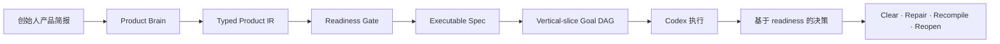

# 超越 Fable 构建产品

Founder Product Compiler 将创始人的产品意图转化为 Codex 可以执行的、一致且
经过验证的构建契约。

Fable 是促成这个项目诞生的参考产品和质量标杆。Founder Product Compiler 的
设计目标是从最初的产品简报到实现评审，全程保留产品意图，帮助团队超越这个
标杆。它不是未经验证、声称任何工具都能自动构建更好产品的承诺。

[English](../../README.md) · [한국어](README.ko.md) ·
[日本語](README.ja.md) · [简体中文](README.zh-CN.md) ·
[Español](README.es.md)

> 一次定义产品。给 Codex 一份可执行的契约。以你真正想构建的产品为标准，
> 评判最终结果。

## 产品编译器一览

```text
创始人产品简报
    ↓
Product IR + Readiness Gate
    ↓
可执行规格
    ↓
Vertical-slice Goal DAG
    ↓
Codex 执行
    ↓
    基于 readiness 的产品决策
```

## 你将获得什么

### 保留产品论点

避免 Codex 逐个优化工单时丢失你真正想构建的产品。目标用户、问题、产品
承诺、Magic Moment 和非目标会在整个执行过程中保持可见。

### 在编码前发现缺口

在开始实现之前，找出缺失的用户旅程、互相矛盾的决策、薄弱的 acceptance
criteria，以及没有定义的首次使用体验。

### 将意图转化为可执行工作

生成 typed Product IR、readiness report、executable specification，以及
编码代理可以遵循和评审的 deterministic Goal DAG。

### 减少创始人的微观管理

先解决那些会实质改变产品的决策，然后让 Codex 在明确的产品、证据和 autonomy
边界内工作。

### 明确产品决策

v0 的 Product Judge helper 会把 readiness findings 转换为明确的决策：
`CLEAR`、`REPAIR_LOCAL`、`RECOMPILE` 或 `REOPEN_PRODUCT`。这是针对已编译产品
简报的 readiness 决策模型，并不表示 v0 会对完成的代码库执行 Code、Journey 或
Thesis oracle。

## Before / After

Before:

```text
“构建注册流程，添加计费，改进仪表盘，
并让它有高级产品的感觉。”
```

After:

```text
产品论点
├── 目标用户
├── 痛苦的替代方案
├── 产品承诺
├── Magic Moment
└── 非目标

可执行构建契约
├── readiness verdict
├── 用户旅程
├── vertical slices
├── global acceptance
├── autonomy budget
└── deterministic Goal DAG
```

## 如何实现

Founder Product Compiler 在创始人意图和代码生成之间加入产品级推理层。



### Product Brain

将用户、问题、产品承诺、Magic Moment、约束和非目标整理成一套产品逻辑。

### Typed Product IR

把自然语言意图转换为结构化、经过 schema validation 的模型。

### Readiness Gate

当关键产品决策缺失、互相矛盾，或没有连接到可验证的 acceptance condition
时，阻止过早开始实现。

### Vertical-slice Goal DAG

围绕完整的用户价值规划工作，而不是把前端、后端和基础设施变成互相脱节的
技术层任务。

### Product Judge 决策模型

库提供一个小型的、基于 readiness 的决策 helper。它根据编译后的 Product IR
和 readiness report 返回 `CLEAR`、`REPAIR_LOCAL`、`RECOMPILE` 或
`REOPEN_PRODUCT`。v0 CLI 不会生成 `product-judge.json`，也不会对完成的实现
执行 Code、Journey 或 Thesis oracle。证据 adapter 和更丰富的产品级判断属于
未来路线图。

## 有何不同

| 方式 | 提供什么 | Founder Product Compiler 增加什么 |
| --- | --- | --- |
| Prompt collection | 可复用的指令 | typed product artifact 和 readiness contract |
| Task planner | 实现任务列表 | global acceptance 和 vertical-slice sequencing |
| Autonomous coding agent | 直接修改代码 | 代码执行前可评审的边界 |
| Founder Product Compiler | 从产品意图到构建契约 | 代码执行前的产品级 readiness 决策 |

它不是另一个 coding agent。它告诉编码代理整个产品应该成为什么样子，以及在
认为工作完成之前如何发现 drift。

## 60 秒开始使用

### 1. 安装 Codex 插件

从经过验证的不可变发布提交中，将 repository marketplace 添加到 Codex：

```text
codex plugin marketplace add plugtheliam/founder-product-compiler --ref 2a869c0a83f7547eb4e964b9b75543be2ec5d93a
```

打开 `/plugins`，安装 `founder-product-compiler`，然后开始新会话。完整的 40
字符 SHA 是经过验证的安装目标。`v0.1.0` 标签只是用于浏览的 convenience tag；
复制安装命令时，不要用 moving branch 或 tag 替换它。

### 2. 向 Codex 提供产品简报

附加或粘贴 JSON/YAML 简报，然后调用：

```text
$founder-product-compiler
```

也可以使用以下指令：

```text
Use Founder Product Compiler to turn the attached product brief into
a validated executable specification.

Ask me only about decisions that materially affect the product.
Do not begin implementation until the readiness gate passes.
```

### 3. 评审生成的契约

Codex skill 默认写入 `.product/founder-product-compiler/<slug>`。`READY` compilation
会生成：

```text
.product/founder-product-compiler/<slug>/
├── product-ir.json
├── readiness.json
├── executable-spec.json
├── goal-dag.json
├── diagnostics.json
└── compilation-receipt.json
```

当前 v0 compiler 会生成上面的六个 JSON artifact。`NOT_READY` 运行只会生成
partial Product IR、readiness、diagnostics 和 receipt，不会生成 executable
specification 或 Goal DAG。

standalone compiler 也接受 JSON 或 YAML，需要 Node.js 20 或更高版本：

```bash
npm ci
npm run build
node dist/src/cli.js --input examples/canonical-input.json --out .product/out
npm run validate:schemas -- .product/out
```

`READY` 以 `0` 退出，`NOT_READY` 以 `2` 退出，格式错误或不安全的输入以 `1`
退出。现有 artifact 需要显式使用 `--force` 才能覆盖；symlink 目标和 symlink
output directory 会被拒绝。

## 信任与安全

- Local-only runtime：不需要产品账户、API key、网络或身份验证。
- 没有 MCP 服务器，也没有遥测、分析、部署或 OpenAI endorsement。
- compiler 不会修改产品代码，也不会发布生成的 artifact。
- source binding 和 deterministic artifact 让决策可以被评审。
- readiness gate 会报告缺失信息，而不是虚构产品承诺、旅程或目标。

运行时没有账户、网络或遥测。runtime 不需要产品账户、API key、network 或
auth。

由于 marketplace metadata 声明了 `ON_INSTALL`，Codex host marketplace 安装
仍可能请求 host authorization。请参阅 [SECURITY.md](../../SECURITY.md)、
[PRIVACY.md](../../PRIVACY.md) 和
[THIRD_PARTY_NOTICES.md](../../THIRD_PARTY_NOTICES.md)。

## 兼容性与限制

公开版本是 English-first、Apache-2.0、skills-only，并针对 repository-native
compiler boundary 进行测试。它不包含 multi-agent runtime、deployment
automation、browser automation、billing UI、runtime autonomy-budget
enforcement 或 Fable replacement benchmark。

如果需要不启动 Codex 会话的 deterministic 本地编译，请使用 standalone CLI。
如果希望 Codex 询问缺失的决策并从生成的契约继续工作，请使用 plugin。

## 路线图

- 让韩语、日语、Simplified Chinese 和西班牙语文档与 English README 保持同步
- 增加面向创始人的示例、readiness fixture 和 product-judge decision test
- 实现 pause、rollback、cancellation 和 autonomy budget 的 runtime enforcement
- 增加面向实现后判断的 Code、Journey 和 Thesis evidence adapter
- 增加与参考产品的 evidence-backed comparison
- 完成 listing 和 policy review 后提交 public plugin directory

## 开发与发布检查

```bash
npm ci
npm run typecheck
npm test
npm run build
npm run build:plugin
npm run validate:public
npm run check:plugin
```

请阅读[架构](../../docs/ARCHITECTURE.md)、[diagnostic contract](../../docs/DIAGNOSTICS.md)、
[示例](../../docs/EXAMPLES.md)和[public release plan](../../docs/PUBLIC_RELEASE_PLAN.md)。
公开示例请参阅 [showcase](../../docs/SHOWCASE.md)、[roadmap](../../docs/ROADMAP.md)
和 [translation guide](../../docs/TRANSLATION_GUIDE.md)。发布内容和 repository
metadata 可使用 [social-preview asset](../../docs/assets/social-preview.svg)。

## 参与贡献

请先阅读 [CONTRIBUTING.md](../../CONTRIBUTING.md)。修改 compiler 行为时应添加
测试、保留 deterministic output，并在相关时更新生成的 plugin artifacts。文档翻译
应遵循 canonical English README 的相同 section order。

如果发现产品缺口、难以理解的输出或有用的 founder workflow，请[提交 issue](https://github.com/plugtheliam/founder-product-compiler/issues/new/choose)、
提议示例或[发起 discussion](https://github.com/plugtheliam/founder-product-compiler/discussions/categories/q-a)。
如果 Discussions 暂不可用，issue 链接仍然可以使用。如果这个项目对你有帮助，
请给 repository 加 star，并分享给使用 Codex 构建产品的创始人或产品团队。

## 许可证

Apache-2.0。请参阅 [LICENSE](../../LICENSE)。
